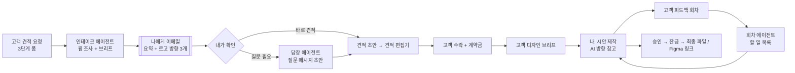

# AI 에이전트 워크플로우

의뢰가 들어오면 **AI가 조사하고 초안을 만들고, 나는 확인하고 보낸다.**
고객에게 나가는 모든 것(견적, 메시지, 시안, 파일)은 내가 버튼을 눌러야만 나가요. AI 결과물은 디자이너 포털에만 보여요.



## 지금 만들어져 있는 것

| 단계 | 에이전트 | 언제 실행 | 결과가 보이는 곳 |
|---|---|---|---|
| 의뢰 접수 | **인테이크** (`intake`) | 견적 요청이 들어오는 즉시 자동 | 디자이너 포털 → 요청 → **AI 브리프** 탭, 그리고 내 이메일 |
| 고객과 대화 | **답장 초안** (`reply`) | 메시지 탭의 **AI 답장 초안** 버튼 | 메시지 입력칸 (보내기 전 수정 가능) |
| 수정 회차 | **회차 정리** (`round`) | 고객이 수정 의견을 보내면 자동 | 디자인 탭 → 피드백 회차 아래 "이번 회차 할 일" |
| 블로그 | **글 초안** (`post`) | 저널 편집기의 **초안 쓰기** 버튼 | 편집기에 제목·요약·본문이 채워짐 (공개 전 수정) |

### 인테이크 에이전트가 만들어 주는 것
1. **웹 조사**: 고객 웹사이트·SNS, 업종, 비슷한 업체 3–5곳 (출처 링크 포함)
2. **요약** 3문장, 고객·타깃·목표
3. **브랜드 컨셉**: 포지셔닝, 성격, 톤, 키워드, 스토리
4. **로고 방향 A/B/C**: 아이디어, 마크, 서체, 4색 팔레트(hex), 이유, 위험 요소
5. **납품물 계획**: 웹·앱은 Figma + PDF만, 페이지/화면 목록
6. **마케팅 계획** (고객이 지속 마케팅을 골랐을 때): 채널, 콘텐츠 아이디어, 구글 검색 광고 키워드, 블로그 주제, 월간 계획
7. **견적 초안** → 버튼 하나로 견적 편집기에 들어가요
8. **고객에게 물어볼 질문** → 버튼 하나로 메시지에 들어가요
9. **주의할 점**, **다음 할 일**

브리프는 기본으로 **한국어**로 써요 (`STUDIO_LANG` 환경변수로 변경). 고객 답장 초안은 **고객이 쓴 언어**로 써요.

## 서비스별로 AI와 내가 하는 일

| 서비스 | AI가 하는 일 | 내가 하는 일 | 고객에게 주는 것 |
|---|---|---|---|
| 로고 / 브랜드 | 조사, 컨셉, 방향 3개, 팔레트·서체 제안 | 실제 디자인, 방향 선택, 수정 | 로고 파일, 미니 가이드 |
| 웹사이트 디자인 | 사이트맵, 페이지별 구성, 경쟁사 사이트 분석 | Figma 디자인 | **Figma 링크 + PDF** (개발 없음) |
| 앱 디자인 | 사용자 과업, 화면 목록, 비슷한 앱 분석 | Figma 디자인 | **Figma 링크 + PDF** (개발 없음) |
| 브로셔 / 명함 / SNS 세트 | 문구 초안, 구성안 | 디자인 | 인쇄용 PDF, 이미지 |
| 간판 / 공간 | 사례 조사, 체크리스트 | 현장 정보 확인, 디자인 | PDF 시안 |
| 지속 마케팅 | 아래 "마케팅 에이전트" 참고 | 승인, 브랜드 톤 관리 | 월간 리포트, 콘텐츠 |

## 다음 단계: 마케팅 에이전트 (SNS · 구글 광고 · 블로그)

지금은 인테이크 브리프 안에 **마케팅 계획**까지 나오고, **블로그 글 초안**을 쓸 수 있어요.
실제로 매달 운영하려면 아래 순서로 늘리는 걸 추천해요. 단계마다 **내가 승인해야 게시·집행**되는 구조는 그대로 둬요.

1. **콘텐츠 캘린더 에이전트**: 매달 1일, 고객별로 SNS 게시물 8–15개를 제안해요 (캡션, 해시태그, 이미지 방향). 포털에서 고객이 승인하면 확정돼요.
2. **블로그 에이전트**: 고객 업종 키워드로 월 2–4편 초안을 쓰고, 내가 다듬어서 고객 사이트에 올려요.
3. **검색 광고 에이전트**: 키워드 그룹, 광고 문구, 제외 키워드, 예산 배분안을 만들어요. 집행은 내가 Google Ads에서 직접 하거나, 나중에 Google Ads API를 연결해요.
4. **월간 리포트 에이전트**: 게시물·광고 성과(직접 입력하거나 API 연결)를 요약하고 다음 달 제안을 써요.

> 광고 계정, SNS 계정에 AI가 직접 게시·결제하는 기능은 넣지 않았어요. 돈과 고객 브랜드가 걸린 일이라 마지막 버튼은 사람이 누르는 게 안전해요.

## 켜는 방법

```bash
npm install                                   # Claude SDK 설치
export ADMIN_PASSWORD='긴-비밀번호'
export ANTHROPIC_API_KEY='sk-ant-...'         # AI 에이전트
export RESEND_API_KEY='re_...'                # 이메일 (resend.com)
export FROM_EMAIL='WHETŪ Studio <hello@내도메인>'
export STUDIO_EMAIL='나@내도메인'               # 새 의뢰 알림 받을 주소
export SITE_URL='https://내도메인'              # 이메일 속 링크
npm start
```

- 모델: `claude-opus-5-5` (`AI_MODEL`로 변경 가능). 거절 시 자동 대체(fallback)가 켜져 있어요.
- 키가 없으면 AI는 꺼지고 나머지 기능은 그대로 작동해요. 이메일 키가 없으면 서버 콘솔에 "누구에게 무엇을 보낼지"만 찍혀요.
- 데모 모드(서버 없이)에서는 AI가 돌지 않고, 샘플 프로젝트에 **예시 브리프**가 들어 있어요.

## 비용 감각
인테이크 1건은 웹 검색 몇 번과 긴 브리프 1회라서, 대략 의뢰 1건당 0.3~1달러 정도로 예상돼요 (조사량에 따라 달라지고, 실제로 돌려본 금액은 아니에요). 답장·회차·블로그 초안은 그보다 훨씬 적어요. 정확한 금액은 Anthropic 콘솔의 사용량에서 확인하세요.

## 코드 위치
- `server/agents.js`: 에이전트 4개 (프롬프트, 스키마)
- `server/server.js`: 실행 시점, 이메일(`notify`), `/api/requests/:id/ai/*`, `/api/ai/post`
- `js/admin.js`: AI 브리프 탭, 답장 초안, 회차 할 일, 블로그 초안 버튼
- `js/data/sample-brief.js`: 데모용 예시 브리프
